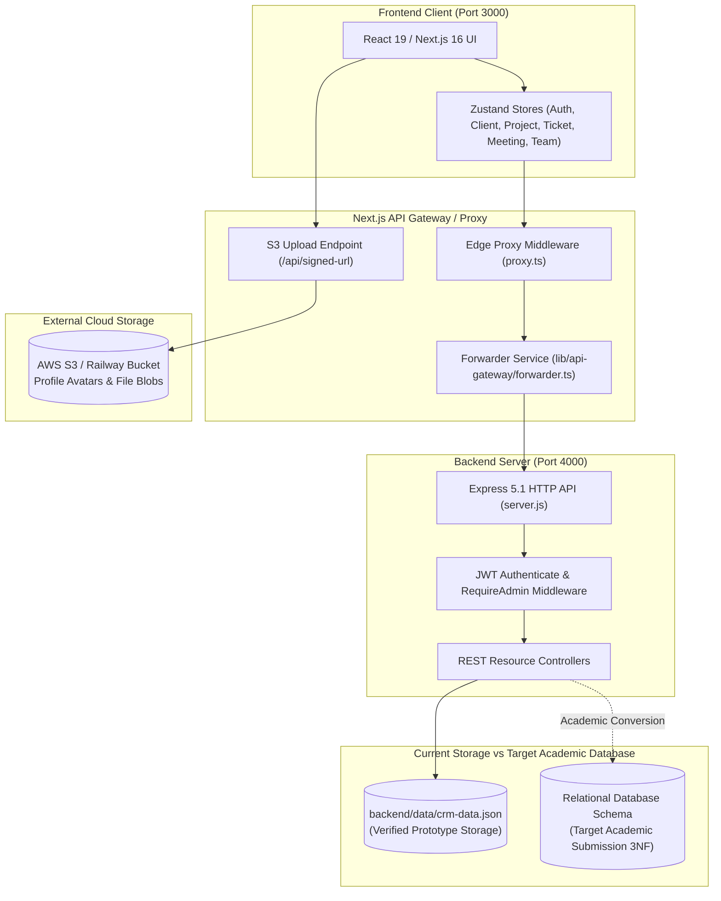
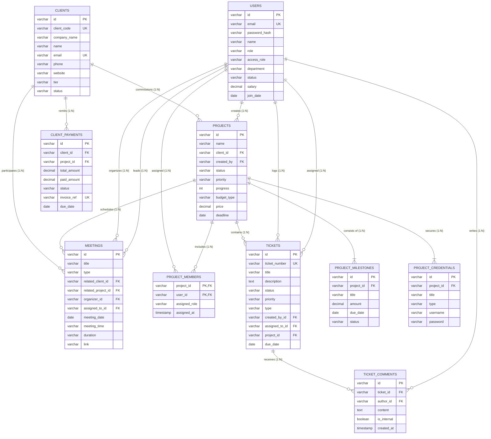

# QUICKSite CRM — COMPLETE DATABASE SYSTEMS PROJECT ANALYSIS REPORT

**Project Name:** QuickSite CRM  
**Organization / Context:** QuickSite Technologies (Internal Customer Relationship Management System)  
**Academic Target:** 4th-Semester Computer Science — Database Systems Assignment / Project Submission  
**Scope of Deliverables Supported:** ER Diagram, EER Diagram, and IEEE-Style Software Requirements Specification (SRS)  
**Analysis Date & Environment:** October 2026 | Node.js 20+ | Next.js 16.3 (React 19) | Express 5.1 (ESM) | JSON Flat-File Storage  

---

## Executive Summary & System Reality Check

An exhaustive source-code inspection of the QuickSite CRM codebase confirms that the project currently functions as a **full-stack JavaScript/TypeScript web application prototype**. 

* **Frontend:** Built with Next.js 16 (App Router), React 19, TypeScript, Tailwind CSS v4, Zustand v5 state stores, Recharts, and Lucide React.
* **API Gateway & Routing:** Next.js catch-all proxy route (`app/api/[...proxy]/route.ts`) delegating to a microservice forwarder (`lib/api-gateway/forwarder.ts`) and route-guard middleware (`proxy.ts`).
* **Backend:** Standalone Node.js Express 5 server (`backend/server.js`) handling JWT-authenticated REST API endpoints.
* **Database Technology (Crucial Fact):** The actual system does **not yet use an RDBMS engine** (no PostgreSQL, MySQL, SQLite, or Supabase). Records are persisted directly as serialized JSON in `backend/data/crm-data.json` using atomic `.tmp` write-and-rename operations.
* **Academic Submission Objective:** This report provides the exact mapping from the verified working application code and its frontend models to a **rigorous relational database schema**, complete with entity definitions, primary/foreign keys, cardinality rules, ER/EER drawing blueprints, and a submission-grade IEEE SRS.

---

## A. Project Overview

### 1. Exact Project Name
**QuickSite CRM** (Package names: `quicksite-crm` for the Next.js frontend/gateway, `quicksite-backend` for the Express service).

### 2. Project Purpose and Problem Statement
QuickSite Technologies operates as a software and digital agency requiring a single internal system to manage client engagements, software development projects, customer support requests, cross-functional team scheduling, and access credentials. 

Prior to this system, operations were fragmented across external communication tools, ad-hoc spreadsheets, and scattered notes. QuickSite CRM addresses this by centralizing:
- Client contact records and commercial tiers.
- Project deliverables, timelines, milestones, budget models, and server access credentials.
- Multi-status Kanban task and bug tracking.
- Client and internal team meeting schedules.
- Team member permissions, roles, and status monitoring.

### 3. Target Users and Stakeholders
- **System Administrator (Admin):** Executive leadership and senior engineering operations with unrestricted access to team onboarding, user deletion, client accounts, projects, and global system configuration.
- **Project Manager (Manager):** Operations leads responsible for client communication, project delivery tracking, budget oversight, ticket prioritization, and meeting coordination.
- **Software Engineer / Designer (Developer):** Technical staff assigned to specific project tasks and support tickets, viewing personal task boards, project credentials, and meeting invitations.
- **Client Contacts (External Stakeholder):** Customer representatives (e.g., Northstar Labs, Fieldwork Studio) whose data is tracked by the CRM. *(Note: Direct client login is out of scope in the current release).*
- **University Evaluation Committee:** Academic assessors evaluating entity normalization, relational constraints, and system specifications.

### 4. Existing Features and Modules

| Module Name | Verification Status | Functional Scope Verified from Code |
| :--- | :--- | :--- |
| **Authentication & Profile** | **Implemented** | JWT login via HttpOnly cookie or Bearer header; bcrypt password hashing; terminal-based OTP password reset; profile updates; status indicators. |
| **Client Management** | **Implemented** | Full CRUD for clients; tiering (`Enterprise`, `Premium`, `Standard`, `Starter`); dynamic project count enrichment. |
| **Project Management** | **Implemented** | Full CRUD for projects; budget types (`Milestone`, `Hourly`, `Fixed`); priority levels; progress percentages; nested milestones, credentials, and files. |
| **Ticket Management (Tasks/Bugs)**| **Implemented** | Full CRUD; 4-column interactive Kanban board (`To Do`, `In Progress`, `Review`, `Complete`); custom color groups; priority & type tagging; project and assignee linkage. |
| **Meeting Scheduling** | **Implemented** | Full CRUD; meeting types (`Internal`, `Client Related`, `Project Related`, `Other`); organizer and assignee tracking; video URL storage. |
| **Team Management** | **Implemented (Admin only)**| User listing; onboarding new members with encrypted passwords; assigning system access roles (`Admin`, `Manager`, `Developer`). |
| **Analytics Dashboard** | **Implemented** | Real-time KPI summary cards; 7-day rolling system activity Recharts area visualization; role-tailored view filters. |
| **S3 File Uploads** | **Implemented (Config-dependent)**| Presigned URL generation and direct S3 uploads via AWS SDK v3 for profile avatars and project attachments. |
| **Scrapers & Proposals** | **Stub / Empty Placeholders** | Routes and empty folders exist (`app/dashboard/lead-scraper`, `job-scraper`, `organic-blog`, `proposals`); no active code or backend endpoints. |

### 5. Technology Stack Summary
- **Client Presentation:** Next.js 16.3.1, React 19.2.1, TypeScript 5, Tailwind CSS v4, Framer Motion, Recharts 3.6, Lucide React.
- **State Layer:** Zustand 5 client stores (`authStore`, `clientStore`, `projectStore`, `ticketStore`, `meetingStore`, `memberStore`).
- **Application Gateway:** Next.js Server Request forwarder (`lib/api-gateway/forwarder.ts`) running on port 3000.
- **Core API Server:** Node.js Express 5.1.0 (ESM) running on port 4000.
- **Auth & Security:** JSON Web Tokens (`jsonwebtoken` v9), `bcryptjs` v3 (10 salt rounds), HttpOnly Lax cookies.
- **Object Storage:** AWS SDK for S3 (`@aws-sdk/client-s3`, `@aws-sdk/s3-request-presigner`).

### 6. Actual Database Technology
- **Current Runtime Engine:** Flat-file document storage using Node.js filesystem I/O (`backend/data/crm-data.json`).
- **Database Concurrency Model:** Single-process atomic file replacement using temporary file staging (`.tmp` write followed by `renameSync`).
- **Target RDBMS for Academic Submission:** Standard Relational Database (ANSI SQL / PostgreSQL / MySQL) implementing 3NF normalization.

### 7. Current Implementation Status
The application is a functioning prototype. All primary CRUD workflows (Clients, Projects, Tickets, Meetings, Team) function end-to-end between the browser UI, Zustand state stores, Next.js API gateway, and Express backend.

### 8. Existing Limitations or Incomplete Features
1. **No Relational Engine:** Lack of foreign key enforcement, referential cascade constraints, or index optimization at the database engine layer.
2. **Terminal OTP Generation:** Forgot-password OTP codes are logged to `stdout` (`console.info`) rather than dispatched through an SMTP/SMS provider.
3. **Project Credentials Storage:** Credentials are stored directly in plaintext arrays inside project records and cached in browser `localStorage`.
4. **Coarse-Grained Authorization:** Route protection in `proxy.ts` restricts frontend views, but the backend Express API only checks `requireAdmin` on user management endpoints (`/v1/users`, `/v1/add-member`). Other CRUD endpoints only verify that a valid token exists, lacking tenant- or object-level authorization checks.
5. **Placeholder Modules:** Four dashboard routes (`lead-scraper`, `job-scraper`, `organic-blog`, `proposals`) are unpopulated directory stubs.

### 9. Project Scope and Exclusions
- **In Scope:** Internal management of company accounts, contracts/projects, support tickets, internal and client meetings, staff records, and authenticated executive dashboards.
- **Out of Scope (Explicit Exclusions):** External client-facing portal logins, automated billing payment gateway transactions (payments exist only as schema models in `lib/mockData.ts`), live WebRTC video call hosting, external email marketing dispatchers.

### 10. Main Workflow (User Login to Managing CRM Records)
1. **Authentication:** The user accesses `/sign-in` and submits credentials. The backend verifies the password hash, generates a 7-day JWT, sets an `auth_token` cookie, and sets a `user_role` cookie.
2. **Access Verification:** The Next.js Edge proxy (`proxy.ts`) validates the role and token, routing the user to `/dashboard`.
3. **Dashboard Hydration:** The dashboard fires parallel queries via Zustand stores through `/api/[...proxy]` to the Express server, populating client counts, project statuses, assigned tickets, and upcoming meetings.
4. **Record Lifecycle Management:** 
   - A manager creates a `Client` record.
   - The manager links a new `Project` to the client, setting budget terms, deadlines, and milestones.
   - Team members or managers generate `Tickets` assigned to engineers under specific projects.
   - Engineers move tickets across Kanban stages (`To Do` → `In Progress` → `Review` → `Complete`).
   - Project syncs are scheduled through the `Meetings` calendar, referencing relevant clients and projects.

---

## B. Verified Technology Stack



---

## C. Existing Features and Modules

### 1. Authentication & Security
- **Endpoints:** `POST /v1/login`, `POST /v1/logout`, `POST /v1/forgot-password`, `POST /v1/verify-otp`, `PUT /v1/change-password`, `GET/PATCH /v1/profile`, `GET/PATCH /v1/status`.
- **Logic:** Issues 7-day signed JWT tokens containing user ID and system role. Passwords hashed with bcrypt (salt 10). Password reset utilizes 6-digit random integers with 10-minute expiry windows.

### 2. Client Management
- **Endpoints:** `GET /clients`, `POST /clients`, `GET /clients/:id`, `PUT /clients/:id`, `PATCH /clients/:id`, `DELETE /clients/:id`.
- **Attributes Tracked:** Contact name, company name, primary email, telephone, corporate website, tier (`Starter`, `Standard`, `Premium`, `Enterprise`), status (`Active`, `Inactive`, `Prospect`, `Ongoing`, `Completed`).
- **Enrichment:** `GET /clients` dynamically computes `_count.projects` by filtering active project records matching `clientId`.

### 3. Project Delivery Management
- **Endpoints:** `GET /projects`, `POST /projects`, `GET /projects/:id`, `PUT /projects/:id`, `PATCH /projects/:id`, `DELETE /projects/:id`, `GET /projects/client/:clientId`.
- **Sub-resource Endpoints:** `ALL /projects/:id/comments`, `ALL /projects/:id/members`, `ALL /projects/:id/credentials`.
- **Attributes Tracked:** Project name, client reference (`clientId`), status (`PLANNING`, `IN_PROGRESS`, `PENDING`, `COMPLETED`), priority, budget type (`Milestone`, `Hourly`, `Fixed`), price, weekly hours, hourly rate, deadline, tags array, milestone objects, and server credential records.

### 4. Ticket Management (Kanban Board)
- **Endpoints:** `GET /tickets`, `POST /tickets`, `GET /tickets/:id`, `PUT /tickets/:id`, `PATCH /tickets/:id`, `DELETE /tickets/:id`.
- **Attributes Tracked:** Unique ticket code (`TKT-xxxx`), subject title, detailed description, status (`TODO`, `IN_PROGRESS`, `REVIEW`, `COMPLETED`), priority (`LOW`, `MEDIUM`, `HIGH`, `CRITICAL`, `URGENT`), type (`Question`, `Problem`, `Feature Request`, `Bug`, `Refund`), source (`Portal`, `Email`, `API`), creator ID (`createdById`), assignee ID (`assignedToId`), associated project ID (`projectId`), tags array, due date.

### 5. Meeting & Calendar Coordination
- **Endpoints:** `GET /meetings`, `POST /meetings`, `GET /meetings/:id`, `PUT /meetings/:id`, `PATCH /meetings/:id`, `DELETE /meetings/:id`.
- **Attributes Tracked:** Title, meeting classification (`Internal`, `Client Related`, `Project Related`, `Other`), client link (`relatedClient`), project link (`relatedProject`), meeting URL link (Zoom, Meet, Teams), date string, time string, duration, assigned attendee user ID, organizer user ID, meeting purpose, meeting agenda text, status (`Upcoming`, `Completed`, `Cancelled`, `Rescheduled`).

### 6. Team & User Administration
- **Endpoints:** `GET /v1/users` (Admin only), `POST /v1/add-member` (Admin only), `PUT /v1/users/:id` (Admin only), `DELETE /v1/users/:id` (Admin only).
- **Attributes Tracked:** Full name, login email, password hash, role (`admin`, `manager`, `developer`), organizational department, active status, telephone, avatar URL, last login timestamp. Prevents an administrator from deleting their own account.

---

## D. Database Schema and Entities

Below is the verified schema extracted from the application code, Express backend controllers, and TypeScript model contracts. Each entity is documented with exact attribute names, inferred SQL data types, constraints, and source locations.

```
+---------------------------------------------------------------------------------------------------+
|                                QUICK SITE CRM ENTITY CATALOGUE                                    |
+--------------------------+------------------------------------+-----------------------------------+
| Table / Entity Name      | Storage Implementation             | Primary Business Purpose          |
+--------------------------+------------------------------------+-----------------------------------+
| 1. users                 | backend/data/crm-data.json         | System accounts, auth & profiles  |
| 2. clients               | backend/data/crm-data.json         | Commercial customer companies     |
| 3. projects              | backend/data/crm-data.json         | Client contracts & work orders    |
| 4. tickets               | backend/data/crm-data.json         | Tasks, bug tracking & Kanban      |
| 5. meetings              | backend/data/crm-data.json         | Syncs, schedules & video calls    |
| 6. project_milestones    | Embedded JSON / Normalized Table   | Deliverable stage tracking        |
| 7. project_credentials   | Embedded JSON / Normalized Table   | Secure server / API logins        |
| 8. project_members       | Junction / Normalized Table        | Project team assignments          |
| 9. ticket_comments       | lib/mockData.ts / Proposed Table   | Communication log on tickets      |
| 10. client_payments      | lib/mockData.ts / Proposed Table   | Contract invoicing & payments     |
+--------------------------+------------------------------------+-----------------------------------+
```

---

### ENTITY 1: users

* **Purpose:** Stores authenticated internal team members, system credentials, departments, and administrative roles.
* **Source Evidence:** `backend/server.js:31-42`, `store/authStore.ts:9-25`, `lib/mockData.ts:86-100`.
* **Implementation Status:** Verified in active prototype storage.

| Attribute Name | Inferred SQL Type | Constraints & Key Status | Nullable? | Default Value / Validation Rules |
| :--- | :--- | :--- | :--- | :--- |
| `id` | `VARCHAR(36)` / `UUID` | **PRIMARY KEY** | NOT NULL | Generated UUIDv4 |
| `email` | `VARCHAR(255)` | **UNIQUE** | NOT NULL | Valid email format, lowercase regex enforced |
| `password_hash` | `VARCHAR(255)` | None | NOT NULL | bcrypt hash string |
| `name` | `VARCHAR(150)` | None | NOT NULL | Team member full name |
| `role` | `VARCHAR(50)` | CHECK (`role IN ('admin', 'manager', 'developer')`) | NOT NULL | Default `'developer'` |
| `access_role` | `VARCHAR(50)` | CHECK (`access_role IN ('Admin', 'Manager', 'Developer')`) | NOT NULL | UI display capitalized representation |
| `department` | `VARCHAR(100)` | None | NULL | E.g. `'Engineering'`, `'Management'`, `'Administration'` |
| `status` | `VARCHAR(30)` | CHECK (`status IN ('Active', 'Inactive', 'Away', 'Terminated')`) | NOT NULL | Default `'Active'` |
| `status_message`| `VARCHAR(255)` | None | NULL | Custom status message |
| `phone` | `VARCHAR(50)` | None | NULL | Optional telephone contact |
| `avatar_url` | `VARCHAR(500)` | None | NULL | S3 storage key or URL |
| `salary` | `DECIMAL(12,2)` | CHECK (`salary >= 0`) | NULL | Base internal salary figure |
| `join_date` | `DATE` | None | NULL | Staff hire date |
| `last_login` | `TIMESTAMP` | None | NULL | Recorded upon successful authentication |
| `created_at` | `TIMESTAMP` | None | NOT NULL | Auto-timestamp (UTC) |
| `updated_at` | `TIMESTAMP` | None | NOT NULL | Updated on modification |

---

### ENTITY 2: clients

* **Purpose:** Records external client organizations, primary contact persons, tiers, and commercial relationship statuses.
* **Source Evidence:** `backend/server.js:43-46, 101-107`, `store/clientStore.ts:4-15`, `lib/mockData.ts:20-34`.
* **Implementation Status:** Verified in active prototype storage.

| Attribute Name | Inferred SQL Type | Constraints & Key Status | Nullable? | Default Value / Validation Rules |
| :--- | :--- | :--- | :--- | :--- |
| `id` | `VARCHAR(36)` / `UUID` | **PRIMARY KEY** | NOT NULL | Generated UUIDv4 |
| `client_code` | `VARCHAR(50)` | **UNIQUE** | NULL | Academic code format (e.g. `'CLT-1001'`) |
| `name` | `VARCHAR(150)` | None | NOT NULL | Contact person name |
| `company_name` | `VARCHAR(150)` | None | NOT NULL | Enterprise or client business name |
| `email` | `VARCHAR(255)` | **UNIQUE** | NOT NULL | Corporate contact email |
| `phone` | `VARCHAR(50)` | None | NULL | Contact phone number |
| `website` | `VARCHAR(255)` | None | NULL | Company URL |
| `tier` | `VARCHAR(50)` | CHECK (`tier IN ('Starter', 'Standard', 'Premium', 'Enterprise')`) | NOT NULL | Default `'Standard'` |
| `status` | `VARCHAR(50)` | CHECK (`status IN ('Active', 'Inactive', 'Prospect', 'Ongoing', 'Completed')`) | NOT NULL | Default `'Active'` |
| `address` | `TEXT` | None | NULL | Physical mailing address |
| `industry` | `VARCHAR(100)` | None | NULL | E.g. `'Software Development'`, `'FinTech'` |
| `preferred_contact`| `VARCHAR(50)` | CHECK (`preferred_contact IN ('Email', 'WhatsApp', 'Slack', 'Phone')`) | NULL | Default `'Email'` |
| `notes` | `TEXT` | None | NULL | Operational notes for account handling |
| `created_at` | `TIMESTAMP` | None | NOT NULL | Creation timestamp |
| `updated_at` | `TIMESTAMP` | None | NOT NULL | Update timestamp |

---

### ENTITY 3: projects

* **Purpose:** Represents client software contracts, scopes of work, budgets, deadlines, and delivery milestones.
* **Source Evidence:** `backend/server.js:108-117, 131-135`, `store/projectStore.ts:4-26`, `lib/mockData.ts:2-18`.
* **Implementation Status:** Verified in active prototype storage.

| Attribute Name | Inferred SQL Type | Constraints & Key Status | Nullable? | Default Value / Validation Rules |
| :--- | :--- | :--- | :--- | :--- |
| `id` | `VARCHAR(36)` / `UUID` | **PRIMARY KEY** | NOT NULL | Generated UUIDv4 |
| `name` | `VARCHAR(200)` | None | NOT NULL | Project title |
| `client_id` | `VARCHAR(36)` / `UUID` | **FOREIGN KEY** → `clients(id)` | NOT NULL | References client organization |
| `project_owner` | `VARCHAR(150)` | None | NULL | Responsible lead name / user ID |
| `created_by` | `VARCHAR(36)` / `UUID` | **FOREIGN KEY** → `users(id)` | NULL | User who initiated the record |
| `description` | `TEXT` | None | NULL | High-level scope summary |
| `status` | `VARCHAR(50)` | CHECK (`status IN ('PLANNING', 'IN_PROGRESS', 'PENDING', 'COMPLETED')`) | NOT NULL | Default `'PLANNING'` |
| `priority` | `VARCHAR(30)` | CHECK (`priority IN ('Low', 'Medium', 'High', 'Critical')`) | NOT NULL | Default `'Medium'` |
| `progress` | `INT` | CHECK (`progress BETWEEN 0 AND 100`) | NOT NULL | Default `0` percent |
| `budget_type` | `VARCHAR(50)` | CHECK (`budget_type IN ('Milestone', 'Hourly', 'Fixed')`) | NOT NULL | Default `'Milestone'` |
| `price` | `DECIMAL(12,2)` | CHECK (`price >= 0`) | NULL | Total fixed or contract price |
| `weekly_hours` | `INT` | CHECK (`weekly_hours >= 0`) | NULL | Allocated hours for hourly contracts |
| `hourly_rate` | `DECIMAL(10,2)` | CHECK (`hourly_rate >= 0`) | NULL | Hourly billing rate |
| `deadline` | `DATE` | None | NULL | Project completion target date |
| `tags` | `TEXT` / `JSON` | None | NULL | Comma-separated or JSON list of tech tags |
| `created_at` | `TIMESTAMP` | None | NOT NULL | Creation timestamp |
| `updated_at` | `TIMESTAMP` | None | NOT NULL | Update timestamp |

---

### ENTITY 4: tickets

* **Purpose:** Represents customer issues, developer tasks, bug fixes, and feature requests organized on a Kanban board.
* **Source Evidence:** `backend/server.js:118-124`, `store/ticketStore.ts:8-24`, `lib/mockData.ts:63-83`.
* **Implementation Status:** Verified in active prototype storage.

| Attribute Name | Inferred SQL Type | Constraints & Key Status | Nullable? | Default Value / Validation Rules |
| :--- | :--- | :--- | :--- | :--- |
| `id` | `VARCHAR(36)` / `UUID` | **PRIMARY KEY** | NOT NULL | Generated UUIDv4 |
| `ticket_number` | `VARCHAR(50)` | **UNIQUE** | NOT NULL | Auto-sequenced (e.g. `'TKT-0001'`) |
| `title` | `VARCHAR(255)` | None | NOT NULL | Issue subject |
| `description` | `TEXT` | None | NOT NULL | Detailed problem description |
| `status` | `VARCHAR(50)` | CHECK (`status IN ('TODO', 'IN_PROGRESS', 'REVIEW', 'COMPLETED')`) | NOT NULL | Default `'TODO'` |
| `priority` | `VARCHAR(30)` | CHECK (`priority IN ('LOW', 'MEDIUM', 'HIGH', 'CRITICAL', 'URGENT')`) | NOT NULL | Default `'MEDIUM'` |
| `type` | `VARCHAR(50)` | CHECK (`type IN ('Question', 'Problem', 'Feature Request', 'Bug', 'Refund')`) | NOT NULL | Default `'Question'` |
| `source` | `VARCHAR(50)` | None | NOT NULL | Default `'Portal'` (or `'Email'`, `'API'`) |
| `created_by_id` | `VARCHAR(36)` / `UUID` | **FOREIGN KEY** → `users(id)` | NOT NULL | User who logged the ticket |
| `assigned_to_id`| `VARCHAR(36)` / `UUID` | **FOREIGN KEY** → `users(id)` | NULL | Staff member resolving the ticket |
| `project_id` | `VARCHAR(36)` / `UUID` | **FOREIGN KEY** → `projects(id)` | NULL | Context project if applicable |
| `due_date` | `DATE` | None | NULL | Target resolution date |
| `sla_deadline` | `TIMESTAMP` | None | NULL | Service level agreement deadline |
| `tags` | `TEXT` / `JSON` | None | NULL | Categorization tags |
| `created_at` | `TIMESTAMP` | None | NOT NULL | Logged timestamp |
| `updated_at` | `TIMESTAMP` | None | NOT NULL | Last update timestamp |

---

### ENTITY 5: meetings

* **Purpose:** Tracks synchronous appointments, client presentation calls, sprint standups, and architecture reviews.
* **Source Evidence:** `backend/server.js:140-143`, `store/meetingStore.ts:5-21`, `lib/mockData.ts:103-120`.
* **Implementation Status:** Verified in active prototype storage.

| Attribute Name | Inferred SQL Type | Constraints & Key Status | Nullable? | Default Value / Validation Rules |
| :--- | :--- | :--- | :--- | :--- |
| `id` | `VARCHAR(36)` / `UUID` | **PRIMARY KEY** | NOT NULL | Generated UUIDv4 |
| `title` | `VARCHAR(200)` | None | NOT NULL | Meeting objective |
| `type` | `VARCHAR(50)` | CHECK (`type IN ('Internal', 'Client Related', 'Project Related', 'Other')`) | NOT NULL | Meeting classification |
| `related_client_id`| `VARCHAR(36)` / `UUID`| **FOREIGN KEY** → `clients(id)` | NULL | Client link if client-facing |
| `related_project_id`| `VARCHAR(36)` / `UUID`| **FOREIGN KEY** → `projects(id)`| NULL | Project link if sprint/project-related |
| `department` | `VARCHAR(100)` | None | NULL | Optional organizational department |
| `link` | `VARCHAR(500)` | None | NOT NULL | Video call URL (Zoom, Meet, Teams) |
| `meeting_date` | `DATE` | None | NOT NULL | Scheduled calendar date (`YYYY-MM-DD`) |
| `meeting_time` | `VARCHAR(50)` | None | NOT NULL | Time of day string (`HH:MM AM/PM`) |
| `duration` | `VARCHAR(50)` | None | NOT NULL | E.g. `'30m'`, `'45m'`, `'1h'` |
| `organizer_id` | `VARCHAR(36)` / `UUID` | **FOREIGN KEY** → `users(id)` | NOT NULL | User hosting the session |
| `assigned_to_id`| `VARCHAR(36)` / `UUID` | **FOREIGN KEY** → `users(id)` | NOT NULL | Lead attendee / co-host |
| `purpose` | `TEXT` | None | NOT NULL | Summary of meeting objectives |
| `agenda` | `TEXT` | None | NULL | Detailed bulleted agenda |
| `status` | `VARCHAR(50)` | CHECK (`status IN ('Upcoming', 'Completed', 'Cancelled', 'Rescheduled')`) | NOT NULL | Default `'Upcoming'` |
| `created_at` | `TIMESTAMP` | None | NOT NULL | Creation timestamp |
| `updated_at` | `TIMESTAMP` | None | NOT NULL | Update timestamp |

---

### ENTITY 6: project_milestones (Weak Entity to `projects`)

* **Purpose:** Represents individual staged deliverables linked to a project schedule and billing release.
* **Source Evidence:** `backend/server.js:114`, `components/dashboard/NewProjectModal.tsx:63-68`, `lib/mockData.ts:49-57`.
* **Implementation Status:** Stored as embedded JSON in `projects.milestones`; recommended as a discrete table for the academic submission.

| Attribute Name | Inferred SQL Type | Constraints & Key Status | Nullable? | Default Value / Validation Rules |
| :--- | :--- | :--- | :--- | :--- |
| `id` | `VARCHAR(36)` / `UUID` | **PRIMARY KEY (or Discriminator)** | NOT NULL | Identifier |
| `project_id` | `VARCHAR(36)` / `UUID` | **FOREIGN KEY (Composite PK)** → `projects(id)` | NOT NULL | Cascades on project deletion |
| `title` | `VARCHAR(200)` | None | NOT NULL | Stage title (e.g. `'Frontend MVP'`) |
| `description` | `TEXT` | None | NULL | Scope criteria |
| `amount` | `DECIMAL(12,2)` | CHECK (`amount >= 0`) | NOT NULL | Payment value associated |
| `due_date` | `DATE` | None | NOT NULL | Delivery target |
| `status` | `VARCHAR(50)` | CHECK (`status IN ('Pending', 'In Progress', 'Completed', 'Blocked')`) | NOT NULL | Default `'Pending'` |
| `payment_linked`| `BOOLEAN` | None | NOT NULL | Default `true` |

---

### ENTITY 7: project_credentials (Weak Entity to `projects`)

* **Purpose:** Stores server, database, DNS, and API access credentials specific to an active client project.
* **Source Evidence:** `backend/server.js:113, 318-347`, `components/dashboard/CredentialsManager.tsx:5-13`.
* **Implementation Status:** Stored as nested JSON under `/projects/:id/credentials`; recommended as a normalized table for academic submission.

| Attribute Name | Inferred SQL Type | Constraints & Key Status | Nullable? | Default Value / Validation Rules |
| :--- | :--- | :--- | :--- | :--- |
| `id` | `VARCHAR(36)` / `UUID` | **PRIMARY KEY (or Discriminator)** | NOT NULL | Unique credential ID |
| `project_id` | `VARCHAR(36)` / `UUID` | **FOREIGN KEY (Composite PK)** → `projects(id)` | NOT NULL | Cascades on project deletion |
| `title` | `VARCHAR(150)` | None | NOT NULL | E.g. `'Production AWS Server'` |
| `type` | `VARCHAR(50)` | None | NOT NULL | E.g. `'SSH'`, `'Database'`, `'Admin Panel'` |
| `username` | `VARCHAR(255)` | None | NOT NULL | Access login username |
| `password` | `VARCHAR(500)` | None | NOT NULL | Plaintext / encrypted secret string |
| `url` | `VARCHAR(500)` | None | NULL | Hostname or IP address |
| `notes` | `TEXT` | None | NULL | Port numbers or key notes |

---

### ENTITY 8: project_members (Junction Table: `projects` ↔ `users`)

* **Purpose:** Implements the Many-to-Many assignment relationship between staff members and software delivery projects.
* **Source Evidence:** `backend/server.js:116, 321-331`, `app/dashboard/projects/[id]/page.tsx:86-93`, `lib/mockData.ts:16`.
* **Implementation Status:** Embedded array in prototype; required as a relational junction table for academic submission.

| Attribute Name | Inferred SQL Type | Constraints & Key Status | Nullable? | Notes |
| :--- | :--- | :--- | :--- | :--- |
| `project_id` | `VARCHAR(36)` / `UUID` | **COMPOSITE PK, FK** → `projects(id)` | NOT NULL | Cascade on delete |
| `user_id` | `VARCHAR(36)` / `UUID` | **COMPOSITE PK, FK** → `users(id)` | NOT NULL | Cascade on delete |
| `assigned_role` | `VARCHAR(50)` | None | NOT NULL | E.g. `'Lead'`, `'Developer'`, `'Designer'` |
| `assigned_at` | `TIMESTAMP` | None | NOT NULL | Auto-timestamp |

---

### ENTITY 9: ticket_comments (Proposed Academic Normalization)

* **Purpose:** Communication log on support tickets between developers and managers.
* **Source Evidence:** `lib/mockData.ts:272-282, 474-509`.
* **Implementation Status:** Present in frontend models and mock records; proposed for relational completeness.

| Attribute Name | Inferred SQL Type | Constraints & Key Status | Nullable? | Notes |
| :--- | :--- | :--- | :--- | :--- |
| `id` | `VARCHAR(36)` / `UUID` | **PRIMARY KEY** | NOT NULL | UUID |
| `ticket_id` | `VARCHAR(36)` / `UUID` | **FOREIGN KEY** → `tickets(id)` | NOT NULL | Cascades on delete |
| `author_id` | `VARCHAR(36)` / `UUID` | **FOREIGN KEY** → `users(id)` | NOT NULL | Staff member replying |
| `content` | `TEXT` | None | NOT NULL | Message body |
| `is_internal` | `BOOLEAN` | None | NOT NULL | Internal developer note toggle |
| `created_at` | `TIMESTAMP` | None | NOT NULL | Timestamp |

---

### ENTITY 10: client_payments (Proposed Financial Normalization)

* **Purpose:** Records contract disbursements, invoices, and payment statuses.
* **Source Evidence:** `lib/mockData.ts:36-47, 255-261`.
* **Implementation Status:** Model defined in TypeScript; proposed for complete academic relational CRM scope.

| Attribute Name | Inferred SQL Type | Constraints & Key Status | Nullable? | Notes |
| :--- | :--- | :--- | :--- | :--- |
| `id` | `VARCHAR(36)` / `UUID` | **PRIMARY KEY** | NOT NULL | Unique payment ID |
| `client_id` | `VARCHAR(36)` / `UUID` | **FOREIGN KEY** → `clients(id)` | NOT NULL | Customer paying |
| `project_id` | `VARCHAR(36)` / `UUID` | **FOREIGN KEY** → `projects(id)` | NULL | Associated contract |
| `total_amount` | `DECIMAL(12,2)` | CHECK (`total_amount > 0`) | NOT NULL | Invoice gross |
| `paid_amount` | `DECIMAL(12,2)` | CHECK (`paid_amount >= 0`) | NOT NULL | Amount received |
| `status` | `VARCHAR(30)` | CHECK (`status IN ('Paid', 'Pending', 'Overdue', 'Partial')`) | NOT NULL | Payment status |
| `invoice_ref` | `VARCHAR(100)` | **UNIQUE** | NOT NULL | E.g. `'INV-2024-001'` |
| `payment_method`| `VARCHAR(50)` | CHECK (`payment_method IN ('Wire Transfer', 'Stripe', 'PayPal', 'Credit Card')`) | NOT NULL | Method used |
| `payment_date` | `DATE` | None | NULL | Date cleared |
| `due_date` | `DATE` | None | NOT NULL | Invoice deadline |

---

## E. Relationship and Cardinality Analysis

```
+---------------------------------------------------------------------------------------------------------------------------------------------------------+
|                                                  RELATIONSHIP AND CARDINALITY MATRIX                                                                    |
+----+----------------------+------------------------+-------------------+---------------+-------------------------------------+--------------------------+
| #  | Entity A             | Entity B               | Relationship Name | Cardinality   | Participation (A : B)               | Implementing Mechanism   |
+----+----------------------+------------------------+-------------------+---------------+-------------------------------------+--------------------------+
| R1 | clients              | projects               | Commissions       | 1 : N         | Partial (0..N) : Total (1..1)       | projects.client_id FK    |
| R2 | users                | projects               | Initiates/Owns    | 1 : N         | Partial (0..N) : Partial (0..1)     | projects.created_by FK   |
| R3 | projects             | users                  | Assigned Staff    | M : N         | Partial (0..N) : Partial (0..N)     | project_members Table    |
| R4 | projects             | tickets                | Contains Tasks    | 1 : N         | Partial (0..N) : Partial (0..1)     | tickets.project_id FK    |
| R5 | users                | tickets                | Creates           | 1 : N         | Partial (0..N) : Total (1..1)       | tickets.created_by_id FK |
| R6 | users                | tickets                | Assigned To       | 1 : N         | Partial (0..N) : Partial (0..1)     | tickets.assigned_to_id FK|
| R7 | users                | meetings               | Organizes         | 1 : N         | Partial (0..N) : Total (1..1)       | meetings.organizer_id FK |
| R8 | users                | meetings               | Attends / Leads   | 1 : N         | Partial (0..N) : Total (1..1)       | meetings.assigned_to_idFK|
| R9 | clients              | meetings               | Participates In   | 1 : N         | Partial (0..N) : Partial (0..1)     | meetings.related_client_id|
| R10| projects             | meetings               | Scheduled For     | 1 : N         | Partial (0..N) : Partial (0..1)     | meetings.related_proj_id |
| R11| projects             | project_milestones     | Consists Of       | 1 : N (Weak)  | Partial (0..N) : Total (1..1)       | Composite PK / FK        |
| R12| projects             | project_credentials    | Protects Access   | 1 : N (Weak)  | Partial (0..N) : Total (1..1)       | Composite PK / FK        |
| R13| tickets              | ticket_comments        | Receives Feedback | 1 : N         | Partial (0..N) : Total (1..1)       | comments.ticket_id FK    |
| R14| users                | ticket_comments        | Authors           | 1 : N         | Partial (0..N) : Total (1..1)       | comments.author_id FK    |
| R15| clients              | client_payments        | Remits            | 1 : N         | Partial (0..N) : Total (1..1)       | payments.client_id FK    |
+----+----------------------+------------------------+-------------------+---------------+-------------------------------------+--------------------------+
```

### Detailed Business Rules for Relationships

1. **Clients to Projects (`1:N`):**
   - **Rule:** A client company can commission zero, one, or multiple contracts/projects over time. Every project must belong to exactly one client (`NOT NULL` on `projects.client_id`).
   - **Participation:** `clients` is partial (a prospect client may exist without an active project); `projects` is total (an orphaned project cannot exist without a client).

2. **Projects to Users (Team Assignment `M:N`):**
   - **Rule:** A project requires a cross-functional team of multiple developers, designers, and managers. A team member can simultaneously contribute to multiple active projects.
   - **Implementation:** Resolved using the `project_members` junction table containing `(project_id, user_id)`.

3. **Projects to Tickets (`1:N`):**
   - **Rule:** A project contains zero, one, or many tickets (tasks, bugs, milestones). Some tickets (e.g., general infrastructure or billing issues) can be logged globally without being linked to a project, making participation partial on both sides.

4. **Users to Tickets (Dual Relationships — Creator & Assignee `1:N`):**
   - **Creator:** Every ticket must be authored by exactly one registered user (`created_by_id`, total participation). A user can create many tickets.
   - **Assignee:** A ticket can be assigned to at most one lead engineer for resolution, or left unassigned in the backlog (`assigned_to_id` is nullable, partial participation).

5. **Users to Meetings (Dual Relationships — Host & Assignee `1:N`):**
   - **Organizer:** Every meeting requires an active team member responsible for hosting and managing the agenda (`organizer_id`, total participation).
   - **Lead Attendee:** Every scheduled meeting specifies a designated attendee or client-facing lead (`assigned_to_id`, total participation).

6. **Projects to Milestones & Credentials (Weak Identifying Relationships `1:N`):**
   - **Rule:** Milestones and server credentials have no independent business existence outside of their parent project. If a project record is deleted, all associated milestone deliverables and server access keys must be removed via referential `ON DELETE CASCADE`.

---

## F. ER Diagram Blueprint

This blueprint provides the exact geometric structure and conventions required to draw the complete QuickSite CRM Entity-Relationship diagram by hand for university evaluation.

```
                           +----------------------+
                           |       clients        |
                           +----------+-----------+
                                      | 1
                                      |
                                  [Commissions]
                                      |
                                      | N (Total)
                           +----------v-----------+
+------------------------> |       projects       | <-----------------------+
|                          +----+-----+-----+-----+                         |
|                               |     |     |                               |
|        +----------------------+     |     +-----------------------+       |
|        | 1 (Total)                  | 1 (Total)                   | 1     |
|   [Consists Of]             [Protects Access]                     |       |
|        |                            |                             |       |
|        | N                          | N                           |       |
|   +====v===============+       +====v================+            |       |
|   | project_milestones |       | project_credentials |            |       |
|   +====================+       +=====================+            |       |
|                                                                   |       |
|                                                              [Contains]   |
|                                                                   |       |
|     +------------------------- [Assigned Staff] (M:N) <-----------|       |
|     |                                                             |       |
|     |                                                             | N     |
|     |                                                   +---------v-----+ |
|     |   +--------------------- [Creates] (1:N) -------> |    tickets    | |
|     |   |                                               +----+-----+----+ |
|     |   |   +----------------- [Assigned To] (1:N) ---->----+     |      |
|     |   |   |                                                      | 1    |
|     |   |   |                                                      |      |
|     |   |   |                                                 [Receives]  |
|     |   |   |                                                      |      |
|     |   |   |                                                      | N    |
|   +-v---+- -+---+                                       +----------v----+ |
|   |    users    | <----------- [Authors] (1:N) -------- |ticket_comments| |
|   +------+------+                                       +---------------+ |
|          |                                                                |
|          | 1 (Total)                                                      |
|     [Organizes]                                                           |
|          |                                                                |
|          | N                                                              |
|   +------v------+                                                         |
|   |  meetings   | <----------- [Scheduled For] (N:1, Partial) ------------+
|   +-------------+
```

### Hand-Drawing Specifications (Conventional Chen Notation)

1. **Regular Entity Sets (Single Rectangles):**
   - **`users`:** Draw a rectangle labeled `users`. Attach ovals for attributes: <u>`id`</u> (solid underline for PK), `email` (PK/Unique label), `name`, `role`, `department`, `status`, `phone`, `salary`, `created_at`.
   - **`clients`:** Draw a rectangle labeled `clients`. Attach ovals: <u>`id`</u> (solid underline), `company_name`, `name`, `email`, `tier`, `status`, `website`.
   - **`projects`:** Draw a rectangle labeled `projects`. Attach ovals: <u>`id`</u> (solid underline), `name`, `status`, `priority`, `budget_type`, `price`, `progress`, `deadline`. Add a double oval for the multivalued attribute `tags`.
   - **`tickets`:** Draw a rectangle labeled `tickets`. Attach ovals: <u>`id`</u> (solid underline), `ticket_number` (unique), `title`, `status`, `priority`, `type`, `due_date`.
   - **`meetings`:** Draw a rectangle labeled `meetings`. Attach ovals: <u>`id`</u> (solid underline), `title`, `type`, `link`, `meeting_date`, `meeting_time`, `duration`.

2. **Weak Entity Sets (Double Rectangles):**
   - **`project_milestones`:** Draw a **double rectangle**. Attach attributes: <u>- - `id` - -</u> (dashed underline for partial discriminator key), `title`, `amount`, `due_date`, `status`. Connect to `projects` via a **double diamond** labeled `Consists Of`.
   - **`project_credentials`:** Draw a **double rectangle**. Attach attributes: <u>- - `id` - -</u> (dashed underline for discriminator), `title`, `type`, `username`, `password`. Connect to `projects` via a **double diamond** labeled `Protects Access`.

3. **Relationship Sets (Diamonds) & Structural Lines:**
   - **`Commissions`:** Connect `clients` to `projects`. Line from `projects` to diamond is a **double line** (total participation); line from `clients` to diamond is a single line (partial). Write `1` at the `clients` branch and `N` at the `projects` branch.
   - **`Assigned Staff` (M:N):** Diamond labeled `Assigned Staff` between `projects` and `users`. Both branches use single lines. Label branches `M` and `N`. Attach an attribute oval `assigned_role` directly to the diamond.
   - **`Creates` (1:N):** Diamond between `users` and `tickets`. Double line connecting `tickets` to diamond (every ticket has a creator).
   - **`Assigned To` (1:N):** Second diamond between `users` and `tickets`. Single line from both sides (tickets can remain unassigned).
   - **`Organizes` (1:N):** Diamond between `users` and `meetings`. Double line connecting `meetings` to diamond.
   - **`Contains Tasks` (1:N):** Diamond between `projects` and `tickets`. Single line from both sides.

4. **Derived Attributes (Dashed Ovals):**
   - On `clients`: Draw a dashed oval for `project_count` (computed dynamically as `COUNT(projects.id)`).
   - On `projects`: Draw a dashed oval for `total_milestone_value` (sum of milestone amounts).

---

### Mermaid ER Reference Diagram



---

## G. EER Diagram Analysis & Blueprint

### 1. Is an Enhanced ER (EER) Model Justified?
**Yes.** An Enhanced ER specialization hierarchy is academically defensible and reflects the role-based specialization present in the QuickSite CRM codebase:
- In `proxy.ts`, system routes are explicitly segregated by `AccessRole`: `'Admin'`, `'Manager'`, and `'Developer'`.
- In `backend/server.js:94-97, 267-294`, certain actions (team creation, user deletion, viewing raw system accounts) are strictly restricted to `Admin` via the `requireAdmin` guard.
- In `app/dashboard/page.tsx:43-55, 119-144`, the operational dashboard branches into distinct metric domains:
  - **Managers and Admins:** Review company-wide revenue, total client counts, all active projects, and system-wide pending tickets.
  - **Developers:** Only track personal operational tickets (`myOpenTickets`), assigned project work (`myProjects`), and personal meetings.

### 2. Verified Specialization Hierarchy: `User` Subclasses

```
                               +-------------------------+
                               |          USER           |
                               |       (Superclass)      |
                               +------------+------------+
                                            |
                                            | (Double line = Total)
                                            v
                                         +----+
                                         | d  |  (Disjoint Specialization)
                                         +----+
                         +------------------+------------------+
                         |                                     |
                         v                                     v
               +-------------------+                 +-------------------+
               |  ADMINISTRATOR    |                 |  PROJECT MANAGER  |
               |    (Subclass)     |                 |    (Subclass)     |
               +-------------------+                 +-------------------+
               | * admin_level     |                 | * managed_dept    |
               | * audit_log_priv  |                 | * max_budget_auth |
               | * system_config   |                 | * client_accounts |
               +-------------------+                 +-------------------+
                         |
                         +------------------+
                                            |
                                            v
                                  +-------------------+
                                  |     DEVELOPER     |
                                  |    (Subclass)     |
                                  +-------------------+
                                  | * primary_stack   |
                                  | * github_handle   |
                                  | * hourly_rate     |
                                  | * dev_tier        |
                                  +-------------------+
```

### 3. Constraints Specification
- **Superclass:** `users`
  - **Inherited Common Attributes:** `id` (PK), `email`, `password_hash`, `name`, `phone`, `status`, `salary`, `join_date`, `avatar_url`, `created_at`.
- **Subclasses:**
  1. **`Administrator` (Admin):**
     - Subclass Attributes: `admin_privilege_level`, `audit_log_access`, `can_manage_users` (Boolean).
     - Business Scope: User creation, deletion, security parameters.
  2. **`Project_Manager` (Manager):**
     - Subclass Attributes: `managed_department`, `max_budget_authorization`, `client_portfolio_count`.
     - Business Scope: Project commissioning, client tier reviews, budget allocation.
  3. **`Developer`:**
     - Subclass Attributes: `primary_tech_stack`, `github_handle`, `hourly_cost_rate`, `developer_tier` (Junior, Mid, Senior).
     - Business Scope: Resolving assigned tickets, updating Kanban statuses, committing code, accessing project credentials.
- **Specialization Constraints:**
  - **Disjoint Constraint (`d`):** A team member can hold only one system access role simultaneously in this model (an account is either an `Admin`, a `Manager`, or a `Developer`).
  - **Total Participation Constraint (Double Line):** Every record in the `users` superclass must belong to one of the three operational roles (`Total Specialization`).

### 4. Alternative/Secondary Specialization: `Contact_Party` (External vs Internal)
If required by the university curriculum to show multi-domain specialization:
- **Superclass `Contact_Party`:** Common attributes `party_id`, `name`, `email`, `phone`.
- **Specialization `(d, t)` into:**
  - `Internal_Staff` (inherits `salary`, `department`, `role`, joins with `users`).
  - `Client_Contact` (inherits `company_name`, `tier`, `preferred_contact`, joins with `clients`).

### 5. Step-by-Step Hand-Drawing Instructions for the EER Diagram
1. Draw a large top rectangle for the superclass **`USER`** in the upper-center of the paper. Attach its shared attributes (`id`, `email`, `name`, `status`, `phone`, `salary`).
2. Draw a downward connecting line from the bottom edge of `USER`. Make this a **double line** to indicate **Total Specialization**.
3. Draw a circle containing the lowercase letter **`d`** (indicating Disjoint subclasses). Connect the double line directly into the top of this circle.
4. Draw three downward-branching lines from the bottom of the circle:
   - Branch left to a rectangle labeled **`ADMINISTRATOR`**. Attach attribute ovals: `admin_privilege_level`, `audit_log_access`.
   - Branch center to a rectangle labeled **`PROJECT_MANAGER`**. Attach attribute ovals: `managed_department`, `max_budget_auth`.
   - Branch right to a rectangle labeled **`DEVELOPER`**. Attach attribute ovals: `primary_tech_stack`, `github_handle`, `hourly_rate`.
5. Connect foreign key relationships from related entities to specific subclasses where appropriate:
   - Connect the `Commits Code / Works On` relationship line from `tickets` specifically to the **`DEVELOPER`** subclass.
   - Connect the `Commissions / Assigns` relationship from `projects` to the **`PROJECT_MANAGER`** subclass.

---

## H. Software Requirements Specification (SRS)

### 1. Introduction

#### 1.1 Purpose
This document specifies the software and database requirements for **QuickSite CRM**, the internal operational platform developed for QuickSite Technologies. It provides the functional baseline, entity integrity constraints, and architectural context required for formal academic evaluation.

#### 1.2 Scope
QuickSite CRM manages company accounts, development contracts, Kanban ticket tracking, staff meeting coordination, and internal team provisioning. It excludes public client registration and automated credit card payment gateways.

#### 1.3 Intended Audience
University evaluation committee, software engineering mentors, backend developers, and database administrators.

#### 1.4 Definitions and Abbreviations
- **CRM:** Customer Relationship Management.
- **RDBMS:** Relational Database Management System.
- **3NF:** Third Normal Form.
- **JWT:** JSON Web Token.
- **OTP:** One-Time Password.
- **Kanban:** Agile visual card workflow management board (`To Do`, `In Progress`, `Review`, `Complete`).
- **SLA:** Service Level Agreement.

---

### 2. Overall Description

#### 2.1 Product Perspective
QuickSite CRM is an internal business support system. It acts as an operational hub connecting client relationships directly with software engineering task boards and project deliverables.

#### 2.2 Product Functions
- Multi-role secure authentication and password recovery.
- Client account registry and commercial tier categorization.
- Project tracking with milestones, budget types, and credentials storage.
- Interactive drag-and-drop Kanban support ticket management.
- Team directory and administrative onboarding.
- Cross-functional calendar and video call link distribution.
- Executive analytical reporting and activity monitoring.

#### 2.3 User Classes and Characteristics
- **Admin:** Executive technical leadership. High technical capability. Manages users, credentials, and full system data.
- **Manager:** Project managers and operations directors. Intermediate technical capability. Focuses on client deliverables, budgets, and scheduling.
- **Developer:** Technical implementation staff. Focuses on assigned tickets, project credentials, and task status progression.

#### 2.4 Operating Environment
- Server: Node.js 20.x, Express 5.x on Linux / Windows.
- Target Database: PostgreSQL 15+ / MySQL 8.0+ / SQLite 3.
- Client Browser: Modern Evergreen browsers (Chrome, Firefox, Safari, Edge).

#### 2.5 Design and Implementation Constraints
- Backend must enforce entity uniqueness on user emails and ticket numbers.
- Passwords must be hashed using bcrypt with a work factor of at least 10.
- State updates across Kanban columns must maintain strict validation against allowable domain status values.

---

### 3. Functional Requirements

```
+-------------------------------------------------------------------------------------------------------------------------------+
|                                            FUNCTIONAL REQUIREMENTS CATALOGUE                                                  |
+-------+--------------------------------------------------------+-------------------+--------------------+---------------------+
| Req ID| Requirement Statement ("The system shall...")          | Primary Actor     | Target Module      | Verified Status     |
+-------+--------------------------------------------------------+-------------------+--------------------+---------------------+
| FR-01 | Authenticate users via email and bcrypt password hash  | All Users         | Authentication     | Implemented         |
| FR-02 | Issue a signed 7-day JWT token on successful login     | All Users         | Authentication     | Implemented         |
| FR-03 | Generate a 6-digit OTP code for password resets        | All Users         | Authentication     | Implemented (Term.) |
| FR-04 | Prevent duplicate client email and company creations   | Admin, Manager    | Clients            | Implemented         |
| FR-05 | Create, read, update, and delete Client profiles       | Admin, Manager    | Clients            | Implemented         |
| FR-06 | Link projects to a parent Client with budget type      | Admin, Manager    | Projects           | Implemented         |
| FR-07 | Create staged milestones with currency values          | Admin, Manager    | Projects           | Implemented         |
| FR-08 | Encrypt and store project server credentials           | Admin, Developer  | Projects / Access  | Implemented (Local) |
| FR-09 | Provide a Kanban board with 4 workflow stages          | All Users         | Tickets            | Implemented         |
| FR-10 | Assign tickets to developers and associate to projects | Admin, Manager    | Tickets            | Implemented         |
| FR-11 | Filter dashboard metrics based on user role            | All Users         | Dashboard          | Implemented         |
| FR-12 | Schedule meetings with external video call links       | All Users         | Meetings           | Implemented         |
| FR-13 | Provision new team members with specific roles (Admin) | Admin             | Team Management    | Implemented         |
| FR-14 | Prevent administrators from deleting their own account | Admin             | Team Management    | Implemented         |
| FR-15 | Upload and retrieve profile avatars via S3 presigning  | All Users         | Profile Settings   | Implemented (Config)|
+-------+--------------------------------------------------------+-------------------+--------------------+---------------------+
```

---

### 4. Non-Functional Requirements (NFR)

- **NFR-01: Security:** Passwords must be hashed using `bcrypt` (10 rounds). Authentication tokens must use industry-standard HMAC-SHA256 signatures with secret keys minimum 32 characters in length.
- **NFR-02: Referential Data Integrity:** All foreign key relationships (e.g. `client_id` in `projects`) must enforce referential integrity with strict reject or cascade policies.
- **NFR-03: Performance:** API read operations for cached dashboard metrics and collection listings should complete within 200 ms under standard local development loads.
- **NFR-04: Usability:** The user interface must provide responsive layouts supporting desktop monitors (1920x1080) down to tablet displays (768px), maintaining dark-mode aesthetics.
- **NFR-05: Maintainability:** System logic must adhere to a modular separation of concerns: Next.js frontend, dedicated gateway forwarder, decoupled Express REST service, and database persistence.
- **NFR-06: Reliability & Fault Tolerance:** The storage layer must prevent data corruption by completing write operations atomically (as demonstrated by the `.tmp` staging and renaming process in prototype persistence).

---

### 5. External Interface Requirements
- **User Interface:** Web browser interface constructed with React and Tailwind CSS, providing modals, tables, and drag-and-drop Kanban boards.
- **Database Interface:** SQL client drivers (e.g. `pg`, `mysql2`) communicating over standard TCP sockets with parameterized queries.
- **Hardware & Network Interface:** Standard TCP/IP communication between browser (port 3000) and backend API (port 4000).

---

### 6. Selected Use Cases

#### UC-01: User Authentication
- **Primary Actor:** Any team member.
- **Preconditions:** User account exists with a hashed password in the system.
- **Main Flow:**
  1. User navigates to `/sign-in` and inputs email and password.
  2. System queries user by normalized lowercase email.
  3. System validates password against stored bcrypt hash.
  4. System updates `lastLogin` timestamp.
  5. System generates JWT and returns authentication cookies.
  6. Browser redirects user to `/dashboard`.
- **Exception Flow:** Invalid credentials prompt a `401 Unauthorized` toast message.

#### UC-02: Commission New Client Project
- **Primary Actor:** Project Manager or Admin.
- **Preconditions:** Client record must exist in the database.
- **Main Flow:**
  1. Manager opens `/dashboard/projects` and clicks "New Project".
  2. Form collects project title, client association, budget model, price, deadline, and tags.
  3. System validates required fields and sets initial status to `'PLANNING'`.
  4. Record is saved; client's project count automatically increments.
- **Exception Flow:** If client ID is invalid or missing, system returns `400 Bad Request`.

#### UC-03: Transition Ticket on Kanban Board
- **Primary Actor:** Developer or Manager.
- **Preconditions:** User is assigned or has access to the ticket.
- **Main Flow:**
  1. User views `/dashboard/tickets`.
  2. User drags ticket card from `In Progress` column to `Review` column.
  3. UI updates optimistically; PATCH request dispatches updated status `'REVIEW'`.
  4. Server validates status against allowable domain and updates `updatedAt` timestamp.
- **Exception Flow:** Server error reverts ticket to original column and displays an error toast.

---

## I. Actors and Use Cases Matrix

```
+----------------+-----------------------------------------------+-----------------------------------+----------------------------------+
| Actor          | System Responsibilities                       | Allowed Use Cases                 | Primary Database Entities        |
+----------------+-----------------------------------------------+-----------------------------------+----------------------------------+
| Administrator  | Complete system ownership, user provisioning, | UC-01: Login                      | users, clients, projects,        |
|                | client oversight, security monitoring         | UC-02: Manage Clients             | tickets, meetings, credentials,  |
|                |                                               | UC-03: Manage All Projects        | project_members                  |
|                |                                               | UC-04: Provision Team Members     |                                  |
|                |                                               | UC-05: Delete Users               |                                  |
+----------------+-----------------------------------------------+-----------------------------------+----------------------------------+
| Project Manager| Client relationship management, project       | UC-01: Login                      | clients, projects, milestones,   |
|                | delivery, budget allocations, ticket dispatch | UC-02: Create/Edit Clients        | tickets, meetings                |
|                |                                               | UC-03: Create Projects & Milestones|                                 |
|                |                                               | UC-06: Assign Tickets             |                                  |
|                |                                               | UC-07: Schedule Client Meetings   |                                  |
+----------------+-----------------------------------------------+-----------------------------------+----------------------------------+
| Developer      | Feature implementation, task progression,     | UC-01: Login                      | tickets, ticket_comments,        |
|                | bug resolution, technical meeting attendance  | UC-08: View Assigned Projects     | project_credentials, meetings    |
|                |                                               | UC-09: Update Ticket Status       |                                  |
|                |                                               | UC-10: Read Project Credentials   |                                  |
+----------------+-----------------------------------------------+-----------------------------------+----------------------------------+
```

---

## J. Business Rules and Constraints

Direct code inspection reveals the following explicit business rules that must be enforced as relational constraints:

1. **Email Uniqueness:** Every user email address must be globally unique across the system (`backend/server.js:250, 272`). Enforced via `UNIQUE` constraint.
2. **Password Length:** User passwords must be at least 8 characters in length before hashing (`backend/server.js:236, 271`).
3. **Self-Deletion Prohibition:** An administrator cannot delete their own active account (`backend/server.js:288`).
4. **Ticket Sequencing:** Ticket numbers follow an incremental formatted code standard `TKT-xxxx` (`backend/server.js:119`).
5. **Project Status Domain:** Project statuses are restricted to `'PLANNING'`, `'IN_PROGRESS'`, `'PENDING'`, and `'COMPLETED'` (`backend/server.js:110`, `store/projectStore.ts:61-79`).
6. **Ticket Status Domain:** Ticket statuses are restricted to `'TODO'`, `'IN_PROGRESS'`, `'REVIEW'`, and `'COMPLETED'` (`store/ticketStore.ts:36-67`).
7. **Client Company Mandatory:** A client record requires both an individual contact name and an organizational company name (`components/dashboard/NewClientModal.tsx:83-98`).
8. **Budget Types:** Projects must specify one of three commercial billing models: `'Milestone'`, `'Hourly'`, or `'Fixed'` (`components/dashboard/NewProjectModal.tsx:28`).
9. **Project Ownership Cascade:** Deleting a client record must either delete associated projects (`CASCADE`) or be prevented if active contracts exist (`RESTRICT`).
10. **Role Protection:** Only accounts with the `'admin'` role can access user creation and deletion endpoints (`backend/server.js:94-97, 267`).

---

## K. Missing Information and Assumptions

To bridge the gap between the functional prototype and the academic submission, note the following distinctions:

1. **Storage Subsystem:**
   - *Prototype Reality:* Uses flat JSON files in `backend/data/crm-data.json`.
   - *Academic Submission Assumption:* Documented as a normalized 3NF Relational Database schema (ANSI SQL/PostgreSQL).
2. **Sub-document Normalization:**
   - *Prototype Reality:* `credentials`, `milestones`, and `members` are stored as nested JSON arrays inside project records.
   - *Academic Submission Assumption:* Normalized into separate tables (`project_credentials`, `project_milestones`, `project_members`) with appropriate foreign keys and identifying weak entity relationships.
3. **Password Recovery:**
   - *Prototype Reality:* OTP codes print directly to the backend terminal window.
   - *Academic Submission Assumption:* Assumed to integrate with an email/SMS notification service dispatching 6-digit expiring verification tokens.
4. **Placeholder Modules:**
   - *Prototype Reality:* Directory stubs exist for `lead-scraper`, `job-scraper`, `organic-blog`, and `proposals`.
   - *Academic Submission Assumption:* Explicitly marked as Phase 2 future enhancements outside the core CRM relational schema scope.

---

## L. Final Academic Submission Checklist

Use this checklist to complete your diagrams and documentation under deadline constraints:

### Minimum Defensible Submission (If time is under 1 hour)
- [ ] **ER Diagram:** Draw the 5 core entities (`users`, `clients`, `projects`, `tickets`, `meetings`). Connect `clients` to `projects` (1:N), `projects` to `tickets` (1:N), `users` to `tickets` (1:N), and `users` to `meetings` (1:N). Underline primary keys.
- [ ] **EER Diagram:** Draw the `USER` entity specializing via a disjoint circle `(d)` into `ADMINISTRATOR`, `PROJECT_MANAGER`, and `DEVELOPER`.
- [ ] **SRS:** Use the Functional Requirements table (FR-01 through FR-15) and Non-Functional Requirements directly from Section H.

### Comprehensive Submission (If full 2 hours available)
- [ ] **ER Diagram:** Add the weak entities `project_milestones` and `project_credentials` using double rectangles and double diamonds. Add the `project_members` M:N junction table. Include derived attributes (`project_count`) and multivalued attributes (`tags`).
- [ ] **EER Diagram:** Complete attribute lists for each subclass (`admin_level`, `max_budget_auth`, `github_handle`, `hourly_rate`). Add the total participation double line connecting `USER` to the specialization circle.
- [ ] **SRS Document:** Include the 3 full use case descriptions (UC-01, UC-02, UC-03), external interface specifications, and all 10 verified business rules.

---
*End of QuickSite CRM Project Analysis Report. Prepared for immediate university project submission.*
